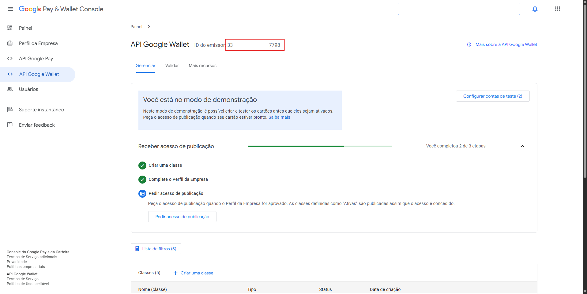

# Google Wallet Studio

Aplicação web para aprender a integrar o **Google Wallet** e emitir passes (carteirinha, ingresso, cartão de fidelidade, cupom, vale-presente) com o botão **Adicionar ao Google Wallet**.

O projeto não é de nenhuma empresa específica: nome do emissor, cores, logo e campos do passe são configuração. Serve como demonstração, como ferramenta interna ou como ponto de partida para a sua integração.

- [O que é o Google Wallet](#o-que-é-o-google-wallet)
- [Como rodar](#como-rodar)
- [Os dois modos de credenciais](#os-dois-modos-de-credenciais)
- [Como criar as suas credenciais](#como-criar-as-suas-credenciais)
- [Como montar um passe](#como-montar-um-passe)
- [Variáveis de ambiente](#variáveis-de-ambiente)
- [Personalização da marca](#personalização-da-marca)
- [Como o código está organizado](#como-o-código-está-organizado)

## O que é o Google Wallet

É a carteira digital do Android. Além de cartões de pagamento, ela guarda **passes**. Com a Google Wallet API, uma empresa emite esses passes e entrega por um botão ou link, no site, no app ou por e-mail. Quem recebe não precisa instalar nada.

### Tipos de passe deste projeto

| Tipo | Para que serve | Exemplos |
| --- | --- | --- |
| **Genérico** (Generic) | Cartão livre, para o que não se encaixa nos outros tipos | Carteirinha de sócio, crachá, comprovante |
| **Ingresso** (Event ticket) | Entrada para um evento, com titular e código | Show, jogo, palestra, cinema |
| **Fidelidade** (Loyalty) | Programa de pontos ou de associação | Clube de vantagens, plano de sócio |
| **Oferta** (Offer) | Cupom ou promoção para resgatar | Desconto, brinde, promoção |
| **Vale-presente** (Gift card) | Cartão pré-pago com número e saldo | Gift card de loja, vale-compra |

A API também tem cartão de embarque e bilhete de transporte, que seguem a mesma lógica e não estão neste projeto.

### Conceitos

- **Classe**: o molde do passe (emissor, logo, o que é igual para todos). Criada uma vez e reaproveitada.
- **Objeto**: o passe de uma pessoa (nome, número, pontos, código), ligado a uma classe.
- **Link assinado**: o servidor assina um JWT com a chave da conta de serviço. O link `https://pay.google.com/gp/v/save/<jwt>` é o destino do botão **Adicionar ao Google Wallet**.
- **QR Code e código de barras**: todo passe pode levar um código (QR Code, Aztec, PDF417 ou Code 128). O valor é seu: matrícula, número do ingresso, cupom. O seu sistema lê o código e valida.
- **Atualização do passe**: pela API, você altera o objeto (pontos, assento, validade) ou a classe (logo, nome), e o passe muda no celular de quem já salvou. Também dá para enviar avisos e expirar um passe.

## Como rodar

Requisitos: Node.js 22 ou superior.

```bash
git clone https://github.com/CauaYves/Google-Wallet.git
cd Google-Wallet
npm install
cp .env.example .env.local   # opcional: só para o modo demonstração e a marca
npm run dev
```

Abra `http://localhost:3000`. Sem nenhuma variável de ambiente o app já funciona no modo **Usar minhas credenciais**.

| Comando | O que faz |
| --- | --- |
| `npm run dev` | Servidor de desenvolvimento |
| `npm run build` e `npm start` | Build e servidor de produção |
| `npm run lint` | ESLint |
| `npm run typecheck` | Verificação de tipos |
| `npm test` | Testes (Vitest) |

## Os dois modos de credenciais

A pessoa escolhe na interface, na etapa **Criar passe**.

### Usar credenciais de demonstração

O passe é emitido pelo emissor configurado no servidor, nas variáveis de ambiente. Serve para ver o fluxo sem configurar nada.

- A chave fica só no servidor. O navegador recebe apenas a informação de que o modo existe.
- O ID da classe é calculado a partir do conteúdo, então um visitante não sobrescreve a classe de outro.
- Há um limite de passes por visitante, por hora (`WALLET_DEMO_MAX_PER_HOUR`). O contador fica em memória: em hospedagem serverless, troque por um armazenamento compartilhado.
- Enquanto o emissor estiver em modo de demonstração no Google, só as contas de teste cadastradas nele conseguem salvar o passe.
- Sem as variáveis, a opção aparece como indisponível.

### Usar minhas credenciais

A pessoa informa o próprio issuer ID e a chave da própria conta de serviço. O passe sai em nome da empresa dela.

- A chave é enviada ao servidor só no clique em **Gerar passe**, dentro da chamada da Server Action.
- O servidor usa a chave em memória para criar a classe e assinar o link, e descarta ao terminar. Nada é gravado em banco, arquivo, cookie, cache ou log, e a chave nunca volta na resposta.
- No navegador a chave fica só no estado da página: some ao recarregar ou fechar a aba. Não usamos `localStorage` nem cookies.
- Em produção, publique o app **somente com HTTPS**: é a conexão que protege a chave no caminho.
- Recomendação para quem usa: crie uma chave só para testar e exclua no Google Cloud ao terminar.

## Como criar as suas credenciais

Você precisa de um **issuer ID** e da **chave de uma conta de serviço** autorizada. É gratuito e leva cerca de 15 minutos. O mesmo passo a passo está na aba **Credenciais** do app.

1. **Conta de emissor e issuer ID.** Acesse o [Google Pay & Wallet Console](https://pay.google.com/business/console), preencha os dados da empresa e abra **Google Wallet API**. O issuer ID é o número no topo da página.

   

2. **Projeto no Google Cloud.** No [Google Cloud Console](https://console.cloud.google.com/projectcreate), crie um projeto ou escolha um existente. Não é preciso ativar faturamento.
3. **Habilite a Google Wallet API.** Em [APIs e serviços › Biblioteca › Google Wallet API](https://console.cloud.google.com/apis/library/walletobjects.googleapis.com), clique em **Ativar**.
4. **Conta de serviço e chave.** Em [IAM e administrador › Contas de serviço](https://console.cloud.google.com/iam-admin/serviceaccounts), crie uma conta de serviço (não precisa de papéis). Abra a conta, vá em **Chaves › Adicionar chave › Criar nova chave** e escolha **JSON**. O arquivo baixado tem `client_email` e `private_key`: trate como senha e nunca coloque no Git.
5. **Autorize a conta no console do Wallet.** No Google Pay & Wallet Console, abra **Usuários › Convidar um usuário**, cole o `client_email` e dê o acesso **Desenvolvedor**. Sem isso a API responde 403.
6. **Modo demo e publicação.** Toda conta de emissor começa em **modo de demonstração**: os passes funcionam, mas só para a conta administradora e para as contas cadastradas em **Configurar contas de teste**. Para emitir a qualquer pessoa, complete o perfil da empresa e peça o **acesso de publicação** na mesma página. Depois de aprovado, o Google revisa as classes criadas.

Referência oficial: [developers.google.com/wallet](https://developers.google.com/wallet).

## Como montar um passe

Na aba **Criar passe**:

1. **Credenciais.** Escolha o modo. Em **Usar minhas credenciais**, informe o issuer ID e selecione (ou cole) o JSON da conta de serviço.
2. **Monte o passe.** Escolha o tipo e preencha: nome do emissor, título, texto principal, subtítulo, cor de fundo, logo, imagem de destaque, tipo e valor do código e até 8 campos extras (nome e valor). A prévia ao lado acompanha o que você digita.
3. **Gere o link.** O servidor cria a classe (ou atualiza, se o ID já existir), monta o objeto e assina o JWT. O resultado é o botão **Adicionar ao Google Wallet** e o link para copiar e usar no seu site, app ou e-mail.

As imagens precisam ser URLs públicas com `https://`.

## Variáveis de ambiente

Todas são opcionais e lidas **só no servidor**. Modelo em [`.env.example`](.env.example).

| Variável | Para que serve |
| --- | --- |
| `GOOGLE_WALLET_ISSUER_ID` | Issuer ID do modo demonstração |
| `GOOGLE_WALLET_SERVICE_ACCOUNT_EMAIL` | E-mail da conta de serviço do modo demonstração |
| `GOOGLE_WALLET_PRIVATE_KEY` | Chave privada, em uma linha, com `\n` no lugar das quebras |
| `GOOGLE_WALLET_SERVICE_ACCOUNT_JSON` | Alternativa às duas anteriores: o JSON inteiro em uma linha |
| `WALLET_DEMO_MAX_PER_HOUR` | Limite de passes de demonstração por visitante, por hora (padrão 20) |
| `APP_NAME` | Nome exibido no topo e no título da página |
| `WALLET_DEFAULT_ISSUER_NAME` | Nome do emissor que já vem preenchido |
| `WALLET_DEFAULT_BACKGROUND_COLOR` | Cor de fundo inicial do passe (`#rrggbb`) |
| `WALLET_DEFAULT_LOGO_URL` | Logo inicial |
| `WALLET_DEFAULT_HERO_IMAGE_URL` | Imagem de destaque inicial |

> **Nunca versione credenciais.** O `.gitignore` já ignora `.env*` (menos o `.env.example`), `credentials.json` e `service-account*.json`. Nenhuma variável de credencial usa o prefixo `NEXT_PUBLIC_`, então nenhuma chega ao navegador.

## Personalização da marca

- **Passe**: tudo vem do formulário ou das variáveis `WALLET_DEFAULT_*`.
- **Interface**: usa o [Mosaico](https://github.com/CauaYves/mosaico), um design system distribuído pelo registry do shadcn. Os componentes ficam em `components/mosaico/` e o `app/globals.css` é reescrito pelo CLI. As cores do projeto ficam em [`app/theme.css`](app/theme.css), carregado depois: hoje é um tema neutro, e é ali que você põe as cores da sua empresa.

Para adicionar ou atualizar um componente do Mosaico:

```bash
npx shadcn@latest add CauaYves/mosaico/<componente>
```

## Como o código está organizado

| Caminho | Conteúdo |
| --- | --- |
| `app/page.tsx` | Página com as três etapas: Entenda, Credenciais e Criar passe |
| `app/actions.ts` | Server Action que valida os dados, resolve as credenciais e devolve o link |
| `lib/wallet/pass-builder.ts` | Validação e montagem de classe e objeto por tipo de passe (funções puras) |
| `lib/wallet/credentials.ts` | Credenciais de demonstração (ambiente) e do usuário (requisição) |
| `lib/wallet/google.ts` | Chamadas à Google Wallet API e assinatura do JWT |
| `lib/config.ts` | Configuração de marca |
| `components/app/` | Telas do projeto |
| `components/mosaico/` | Componentes instalados do Mosaico (não edite à mão) |
| `test/` | Testes unitários |
